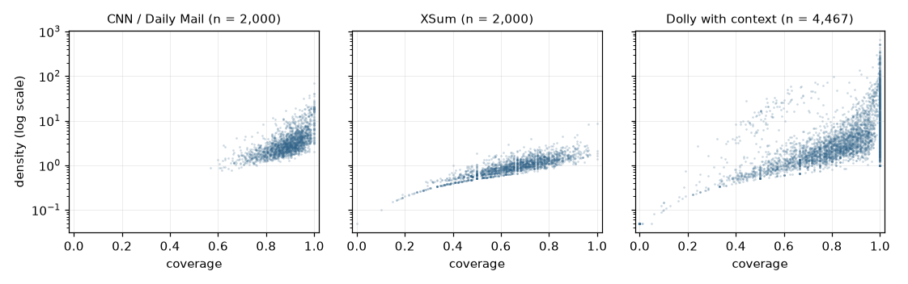

# copyspan

Measure how much of an output text is copied from its source, in which spans and from where, per record and over a
dataset.

The pairs can be a document and its summary, an instruction's input and its answer, or a context and a model's
response. copyspan finds the extractive fragments of each output (the shared token sequences, found greedily as in
Grusky, Naaman and Artzi 2018), reports coverage, density, compression, novel n-gram shares, the longest copied span,
where in the source the copies come from and whether they keep the source order, and summarises a dataset with
quantiles, bootstrap intervals and counts of the two tails.

## Why this is hard

Word overlap alone cannot tell one long copied passage from many scattered shared words: a summary that reuses
seven article words one at a time and a summary that lifts a seven-word clause have the same unigram overlap. The
fragments that separate the two have to be found greedily over the whole source, and a direct search is quadratic in
the lengths, which is slow on long documents and long answers. A dataset mean then hides the two tails that matter
most when a dataset is used for training or evaluation: outputs copied whole from the source, and outputs that share
nothing with it.

## Install

```
pip install git+https://github.com/vipul21435/copyspan
```

Python 3.10 or later; numpy is the only dependency.

## Quickstart

`examples/pairs.jsonl` holds six short document/summary pairs written for this example.

```
copyspan score examples/pairs.jsonl --source document --output summary --id id --format md
```

```
Tokeniser: word regex (words and single punctuation marks), case folded.

| id | n_source | n_output | coverage | density | compression | novel_2 | longest_span | flags |
|---|---|---|---|---|---|---|---|---|
| r1 | 33 | 15 | 1.000 | 15.000 | 2.200 | 0.000 | 15 | slice |
| r2 | 29 | 14 | 0.429 | 0.429 | 2.071 | 1.000 | 1 |  |
| r3 | 31 | 11 | 0.727 | 2.364 | 2.818 | 0.500 | 4 |  |
| r4 | 23 | 11 | 1.000 | 11.000 | 2.091 | 0.000 | 11 | prefix |
| r5 | 16 | 26 | 0.231 | 0.308 | 0.615 | 0.960 | 2 | no_shared_content, longer_than_source |
| r6 | 12 | 2 | 0.500 | 0.500 | 6.000 | 1.000 | 1 | no_shared_content |
```

The default `--format jsonl` writes every measure and the tokeniser per record; `--spans` adds the copied spans as
`{out_start, src_start, length}` token offsets.

```
copyspan summary examples/pairs.jsonl --source document --output summary --id id --boot 1000
```

```
# copyspan summary

Records: 6.
Tokeniser: word regex (words and single punctuation marks), case folded.
Long spans: at least 3 tokens; position and order use fragments of at least 3 tokens; lead = first 25 % of the source.
Fragments: exact search.
Intervals: 95 % percentile bootstrap over records, 1000 resamples, seed 0.

| measure | n | mean | interval | p10 | median | p90 |
|---|---|---|---|---|---|---|
| coverage | 6 | 0.648 | [0.425, 0.871] | 0.330 | 0.614 | 1.000 |
| density | 6 | 4.933 | [0.735, 9.507] | 0.368 | 1.432 | 13.000 |
| compression | 6 | 2.633 | [1.474, 4.160] | 1.343 | 2.145 | 4.409 |
| novel unigrams | 6 | 0.352 | [0.129, 0.575] | 0.000 | 0.386 | 0.670 |
...
```

The report goes on with the remaining measures, the tails table, the position histogram and the flag counts. The
other commands:

```
copyspan compare examples/pairs.jsonl --source document --output summary --other draft --id id
copyspan compare a.jsonl --source document --output summary --id id --other-file b.jsonl --other-output pred
copyspan flag examples/pairs.jsonl --source document --output summary --id id
```

```
| id | flags | coverage | longest span | n_output | n_source |
|---|---|---|---|---|---|
| r1 | slice | 1.000 | 15 | 15 | 33 |
| r4 | prefix | 1.000 | 11 | 11 | 23 |
| r5 | no_shared_content, longer_than_source | 0.231 | 2 | 26 | 16 |
| r6 | no_shared_content | 0.500 | 1 | 2 | 12 |
```

Input is JSON lines (`-` for stdin) or CSV/TSV. Every command takes `--group FIELD` (clustered intervals),
`--tokenizer word|whitespace`, `--keep-case`, `--span-k`, `--min-span`, `--lead`, `--algorithm exact|newsroom` and
`--limit`; `summary` and `compare` take `--full T` (repeatable), `--boot`, `--level`, `--seed` and
`--format md|json`. `python examples/run.py` shows the same steps through the Python API.

## How it works

**Tokens.** `word` (default) keeps words, with inner apostrophes and hyphens, and single punctuation marks;
`whitespace` splits on white space. Case is folded unless `--keep-case`. The tokeniser is printed in every report,
because every measure below moves with it (see the results).

**Extractive fragments** (Grusky, Naaman and Artzi 2018). Walk the output left to right; at position *i* take the
longest token sequence starting at *i* that also occurs in the source, record it as a fragment and continue after
it; a token with no match is skipped. Ties go to the leftmost source position. With F the fragments, S the output
and A the source:

- coverage = (1/|S|) Σ_f |f|, the share of output tokens inside a fragment;
- density = (1/|S|) Σ_f |f|², the average length of the fragment each output token belongs to;
- compression = |A| / |S|.

For non-empty outputs coverage lies in [0, 1] and coverage ≤ density ≤ coverage × (longest fragment), since every
fragment has at least one token. The tests check these bounds on 1,000 seeded random pairs.

**Fast search.** `longest_matches` builds a suffix automaton of the reversed source and runs the reversed output
through it. This gives, for every output position at once, the length of the longest prefix of the rest of the
output that occurs in the source and (from the largest end position stored per state) its leftmost source start,
in time linear in |A| + |S|. The greedy walk then reads the fragments off that array. `fragments_bruteforce`
computes the same definition by direct search; the tests compare the two on 3,000 seeded random pairs over small
vocabularies, where repeats and ties are common.

**The published procedure.** The paper's Figure 3 moves the source index past a match (`j ← j′`) before looking for
the next one, so a longer match that starts inside an earlier, shorter one can be missed (source `a a a b`, output
`a a b`: the exact search finds one fragment of 3, the figure's procedure 2 + 1). The figure also prints the update
test as `|f| < (i′ − i − 1)`, which taken literally never keeps a one-token match; copyspan reads it as
`|f| < (i′ − i)`, the match length, which is what the paper's text describes. `--algorithm newsroom` uses this
procedure. On the three real samples below the two gave identical fragments for every record.

**Novel n-grams** (See, Liu and Manning 2017; Narayan, Cohen and Lapata 2018). For n = 1 to 4, the share of the
output's n-grams, counted with repetition, that do not occur anywhere in the source; undefined (left out of means)
for outputs shorter than n tokens. The novel unigram share equals 1 − coverage, because every copied token is in
the source.

**Long spans.** `longest_span` is the longest token sequence shared by output and source (the maximum of the
longest-match array, which can exceed the longest greedy fragment). `long_span_share` is the share of output tokens
inside fragments of at least `--span-k` tokens (default 3).

**Where copies come from.** Using fragments of at least `--min-span` tokens (default 3; single shared words are
mostly function words), each copied token is placed at its relative position (p + 0.5)/|A| in the source.
`position_mean` is their mean, `lead_share` the share from the first `--lead` of the source (default 25 %), and the
summary pools all copied tokens into a histogram over tenths of the source. `order_kept` says whether the
fragments' source starts are non-decreasing in output order, and `order_concordance` is the share of fragment pairs
in source order (both need two or more such fragments).

**Flags.** `prefix` (the output is the start of the source), `slice` (the output is one contiguous span found
elsewhere in the source), `no_shared_content` (no content word of the output occurs in the source, where a content
word has a letter or digit and is not on a short English function-word list; an output made only of function words
gets the flag too), `longer_than_source`, `empty_output`.

**Dataset summary.** For each measure: the number of records where it is defined, the mean, a 95 % percentile
bootstrap interval over records (2,000 resamples, seed 0 by default) and quantiles (numpy's linear interpolation).
With `--group`, whole groups are resampled and the mean is the ratio of resampled sums to resampled counts, so the
records of one group (several outputs for one source document, one category) move together; with few groups the
interval is itself unreliable. Tails: coverage at least each `--full` threshold (default 0.9 and 1.0), the same for
the long-span share, whole output is one source span, no token copied (coverage 0) and no shared content word, each
with its count, share and interval.

**Comparison.** For two outputs of the same sources (two fields of one file, or two files joined by `--id`, with
the source always taken from the first), the mean of each output and the paired difference a − b with a paired
bootstrap interval (records, or groups, resampled together for both outputs), and the same for each tail.

## Results on real public data

All numbers below come from the commands shown, run here on seeded samples. `scripts/prepare_data.py` downloads the
files and writes the samples outside the repository; no dataset rows are committed.

```
uv run --with pyarrow python scripts/prepare_data.py --out DATA      # 2,000 records per summarisation set, seed 0
copyspan summary DATA/cnndm-sample.jsonl --source source --output reference --id id
copyspan summary DATA/xsum-sample.jsonl --source source --output reference --id id
copyspan summary DATA/dolly-context.jsonl --source source --output response --id id
```

Data:

- CNN / Daily Mail 3.0.0, test split (11,490 pairs; the highlights are the output), from
  https://huggingface.co/datasets/abisee/cnn_dailymail. The card states that the dataset "is released under the
  Apache-2.0 License". Sample: 2,000 pairs drawn with `random.Random(0).sample`.
- XSum, test split (11,334 pairs), from https://huggingface.co/datasets/EdinburghNLP/xsum. The card lists the
  licence as "unknown", so only derived numbers and ids are given here. Sample: 2,000 pairs, seed 0.
- databricks-dolly-15k, from https://huggingface.co/datasets/databricks/databricks-dolly-15k (CC BY-SA 3.0 as
  stated on the card): all 4,467 records of the three categories that come with a reference text (closed_qa,
  information_extraction, summarization), with `context` as the source and `response` as the output.

Means with 95 % bootstrap intervals, word tokeniser, case folded:

| set | records | coverage | density | median compression | novel unigrams | novel bigrams | novel trigrams | novel 4-grams |
|---|---|---|---|---|---|---|---|---|
| CNN / Daily Mail | 2,000 | 0.883 [0.880, 0.887] | 4.01 [3.84, 4.19] | 12.3 | 11.7 % | 48.9 % [48.2, 49.6] | 69.3 % | 79.3 % |
| XSum | 2,000 | 0.653 [0.646, 0.659] | 1.05 [1.03, 1.08] | 14.5 | 34.7 % | 83.7 % [83.2, 84.2] | 95.6 % | 98.4 % |
| Dolly (with context) | 4,467 | 0.830 [0.825, 0.836] | 12.16 [11.13, 13.20] | 5.8 | 17.0 % | 46.2 % [45.2, 47.1] | 59.9 % | 66.9 % |

The tails, as shares of records with a non-empty output:

| set | coverage ≥ 0.9 | coverage = 1 | whole output one source span | no token copied | no shared content word |
|---|---|---|---|---|---|
| CNN / Daily Mail | 47.2 % | 4.2 % | 0.1 % (2) | 0 | 0 |
| XSum | 3.8 % | 0.2 % (5) | 0 | 0.1 % (1) | 0.9 % (18) |
| Dolly (with context) | 46.5 % | 29.8 % | 12.5 % (558: 157 prefixes, 401 slices) | 0.6 % (27) | 0.9 % (42) |



Coverage against density per record, from `copyspan score ... > SET.jsonl` on each sample and
`uv run --with matplotlib python scripts/plot_coverage_density.py docs/coverage-density.png "CNN / Daily
Mail=cnndm.jsonl" "XSum=xsum.jsonl" "Dolly with context=dolly.jsonl"` (records with density 0 are drawn at 0.05).
The vertical band at coverage 1 in the Dolly panel is the 29.8 % of responses made entirely of copied
fragments.

One Dolly response in eight that comes with a context is a verbatim span of it, against one CNN / Daily Mail
highlight in a thousand. The first five XSum ids flagged `no_shared_content` are 39192648, 40108528, 38033551,
39558177 and 35950477 (`copyspan flag DATA/xsum-sample.jsonl --source source --output reference --id id --only
no_shared_content`).

Where the copies come from (share of the tokens in fragments of 3 or more, by tenth of the source): CNN / Daily
Mail takes 29.8 % from the first tenth and 21.8 % from the second, falling to 3.0 % in the last; XSum 12.2, 13.1 and
13.4 % in the first three tenths and 6.6 % in the last; Dolly 13.1 % in the first and 8.2 % in the last.

**Against the published figures.** Narayan, Cohen and Lapata (2018), Table 2, give the share of novel n-grams in
the gold summaries of the test sets: CNN 16.75, 54.33, 72.42, 80.37 %; DailyMail 17.03, 53.78, 72.14, 80.28 %; XSum
35.76, 83.45, 95.50, 98.49 % (unigrams to 4-grams). The XSum sample above is within 1.1 points at every order. For
CNN / Daily Mail the word tokeniser gives lower shares (48.9 % novel bigrams), because punctuation marks become
tokens and are mostly copied; with `--tokenizer whitespace` the same sample gives 16.2, 56.8, 75.1 and 83.7 %, so
the published figures fall between the two. Their preprocessing was not reproduced and the CNN and DailyMail halves
are not separated here, so a gap is expected. Grusky et al. (2018) show coverage and density for CNN / Daily Mail
only as a plot; their Figure 4 gives its median compression as 14:1, against 12.3 (word tokens) and 11.6
(whitespace tokens) on this test sample.

**Comparison.** The lead-3 baseline (the first three sentences of each article, split with a simple regular
expression in `prepare_data.py`) against the reference highlights on the same 2,000 CNN / Daily Mail sources:

```
copyspan compare DATA/cnndm-sample.jsonl --source source --output reference --other lead3 --id id
```

gives density 4.01 against 85.20, a paired difference of −81.19 [−82.13, −80.23], and coverage 0.883 against
1.000 (−0.117 [−0.120, −0.113]); every lead-3 output is flagged as one source span, against 2 references.

**Speed** (measured on a loaded laptop):
`uv run python scripts/bench.py DATA/cnndm-sample.jsonl --source source --output reference --n 300`. On the first
300 CNN / Daily Mail pairs (mean source 664 tokens) the suffix automaton takes 0.85 ms per record and the direct
search 1.36 ms, with identical fragments for all 300. On the first 30 sources joined (20,207 tokens) against their
30 highlights joined (1,197 tokens) it is 28 ms against 1,196 ms; the same joined case on Dolly (6,023-token
source, 3,916-token output) is 6 ms against 1,317 ms. The direct search stays cheap on short summaries because the
greedy walk only searches at fragment starts; its cost grows with the number of fragments times the source length.
The whole `summary` run on the 2,000 CNN / Daily Mail records, bootstrap included, took 15 to 17 s of wall
time (about 9 s of CPU) while the laptop's load average was near 30.

## Limitations

- Fragments are exact token matches after tokenisation and case folding. Inflections, paraphrase and number
  formats ("three to one" against "3-1") count as novel.
- The content-word test uses a short English function-word list; in other languages only the letter-or-digit test
  applies, so `no_shared_content` is weaker there.
- Novel n-gram shares are means of per-record shares; a share pooled over all n-grams of a dataset is not reported.
- Position and order measures ignore fragments shorter than `--min-span`, so outputs with only short copies have no
  value for them (only 862 of the 2,000 XSum records have a fragment of 3 or more tokens).
- Clustered intervals with few groups (for example the three Dolly categories) are not trustworthy, and the code
  does not warn about it.
- A whole input file is read into memory; there is no streaming.
- Only the greedy fragment definition is implemented; there are no alignment-based or semantic measures.

## Related tools

- [contamscan](https://github.com/vipul21435/contamscan) looks for benchmark text inside a corpus by n-gram overlap;
  copyspan measures copying within each source/output pair.
- [datasieve](https://github.com/vipul21435/datasieve) removes duplicate training records.
- [sftlint](https://github.com/vipul21435/sftlint) lints chat and tool-calling datasets.
- [divscore](https://github.com/vipul21435/divscore) measures the diversity of a set of outputs.
- [evalstats](https://github.com/vipul21435/evalstats) gives error bars and paired comparisons for evaluation
  scores.

Papers:

- Max Grusky, Mor Naaman, Yoav Artzi. Newsroom: A Dataset of 1.3 Million Summaries with Diverse Extractive
  Strategies. NAACL 2018. https://aclanthology.org/N18-1065/
- Abigail See, Peter J. Liu, Christopher D. Manning. Get To The Point: Summarization with Pointer-Generator
  Networks. ACL 2017. https://aclanthology.org/P17-1099/
- Shashi Narayan, Shay B. Cohen, Mirella Lapata. Don't Give Me the Details, Just the Summary! Topic-Aware
  Convolutional Neural Networks for Extreme Summarization. EMNLP 2018. https://aclanthology.org/D18-1206/
- Wojciech Kryscinski, Nitish Shirish Keskar, Bryan McCann, Caiming Xiong, Richard Socher. Neural Text
  Summarization: A Critical Evaluation. EMNLP-IJCNLP 2019. https://aclanthology.org/D19-1051/
- Rishi Bommasani, Claire Cardie. Intrinsic Evaluation of Summarization Datasets. EMNLP 2020.
  https://aclanthology.org/2020.emnlp-main.649/
- R. Thomas McCoy, Paul Smolensky, Tal Linzen, Jianfeng Gao, Asli Celikyilmaz. How Much Do Language Models Copy
  From Their Training Data? Evaluating Linguistic Novelty in Text Generation Using RAVEN. TACL 2023.
  https://aclanthology.org/2023.tacl-1.38/

## Licence

MIT. See `LICENSE`.

Built by Vipul Raj Jha · https://vipul21435.github.io
